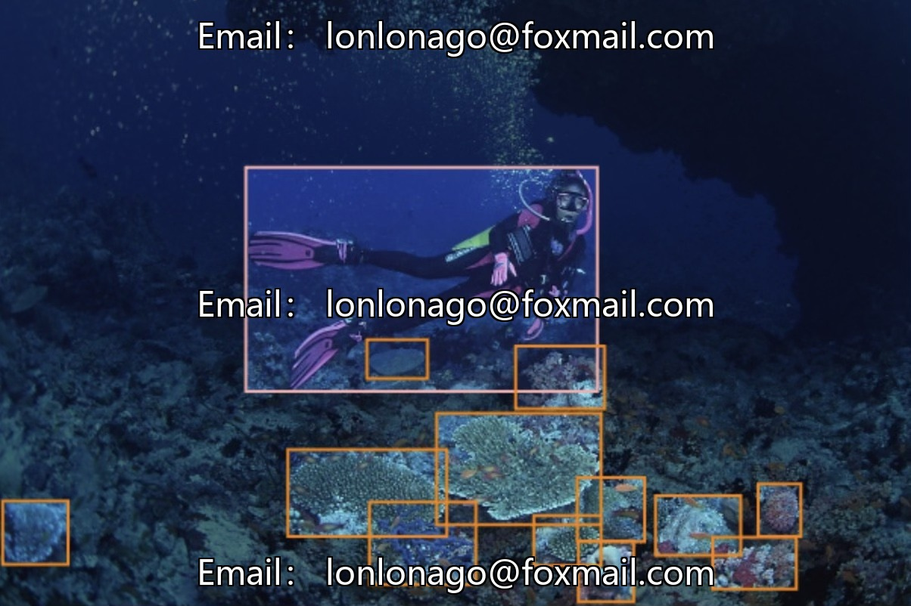
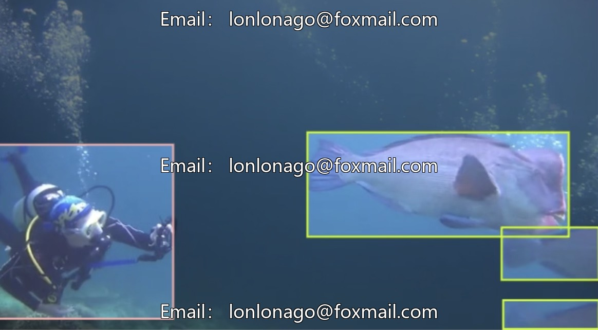
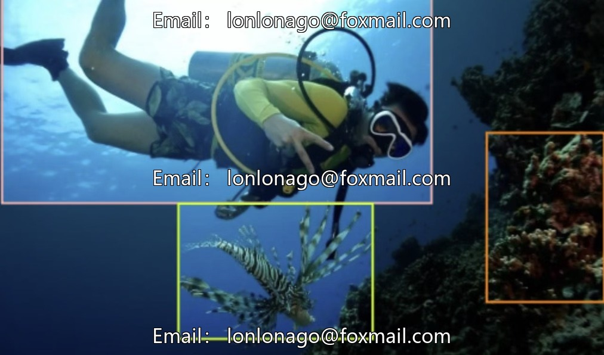
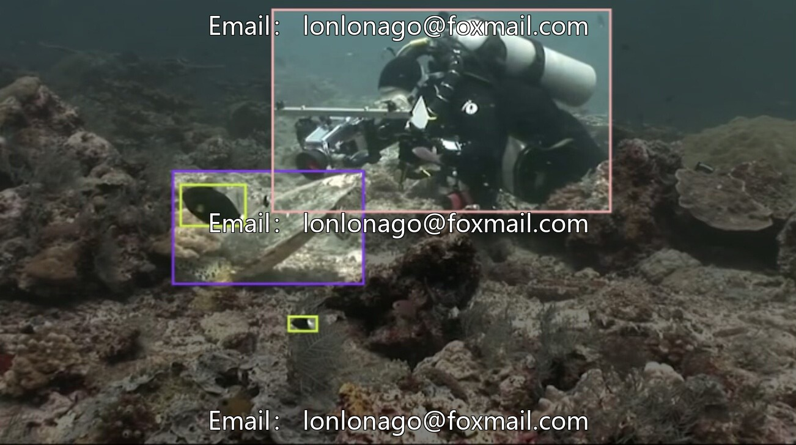
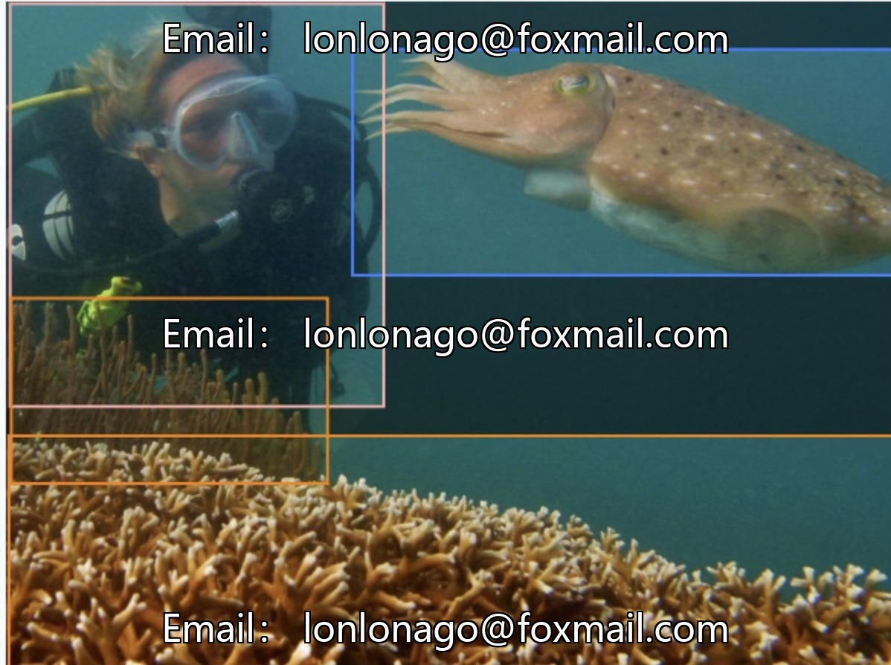

# Underwater target detection image dataset based on the yolo26 algorithm, marine bio-identification specialization

## Body

Underwater target detection image dataset based on the Yolo26 algorithm, specialized for marine bio-identification, including 10 categories such as sea urchins and turtles, totaling 13,000 labeled images in YOLO format. The data is abundant and suitable for scenarios like marine bio-monitoring, diving safety assistance, and underwater environment perception.

The dataset covers common underwater organisms and human activities such as corals, octopuses, divers, sea urchins, fish, scallops, jellyfish, oysters, starfish, and turtles. The categories are aligned with the research needs of underwater scene studies, supporting model training, validation, and testing to enhance underwater target detection and environmental perception capabilities.

Virtual materials, once sold, are non-refundable.
Interested friends, click "I want" to proceed.

## Images

## Payment

Here is a pay link on Stripe ( https://buy.stripe.com/3cs8yP7sY87d0vu9AB ). Please contact me lonlonago@foxmail.com after funding $89, and I will send you a complete data files , thank you!

